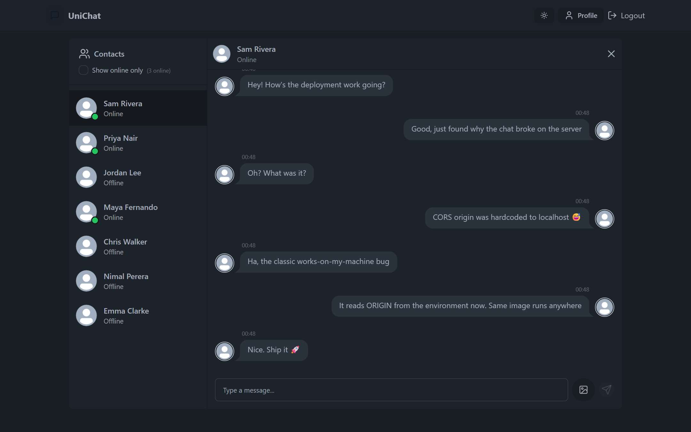
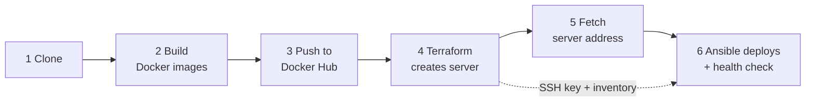
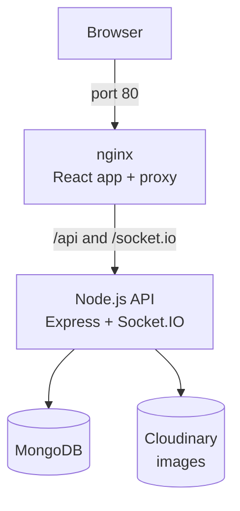

# UniChat: a chat app with a Jenkins, Terraform and Ansible pipeline

A DevOps module project (Semester 5). It is a small real-time chat app, plus a pipeline that builds it, creates a server for it, deploys it, and checks that it works.



## What this project is

We wanted to learn how a change gets from a Git repository to a running server without doing it by hand. So we took a working chat app and built the delivery pipeline around it:

1. **Jenkins** builds two Docker images (the Node.js API, and the React app served by nginx) and pushes them to Docker Hub.
2. **Terraform** creates a fresh Ubuntu server, either an AWS EC2 instance or a free local stand-in container for testing. It also writes the SSH key and the Ansible inventory for that server.
3. **Ansible** installs Docker on the new server and starts the app with Docker Compose.
4. The last pipeline step calls `/api/health` from outside the server, so a green build means the app actually answered.

**Who made what.** The chat app (React frontend, Express backend) is adapted from an open-source MERN project, with changes where deployment needed them. The Dockerfiles, Jenkins pipeline, Terraform, Ansible and configuration are our work for the module.

## Tech stack

| Part | What we used |
|---|---|
| Frontend | React, Vite, Zustand, Tailwind CSS, daisyUI |
| Backend | Node.js, Express, Socket.IO, MongoDB (Mongoose), JWT login, Cloudinary for images |
| Web server | nginx (serves the React build and proxies the API) |
| Containers | Docker, Docker Compose |
| Pipeline | Jenkins (declarative pipeline) |
| Infrastructure | Terraform, Ansible, AWS EC2 (`t3.micro`, `eu-north-1`) |

## How it works

### The pipeline



The pipeline is in [`jenkins/Jenkinsfile`](jenkins/Jenkinsfile). A `DEPLOY_TARGET` setting picks the server: `aws` creates a real EC2 instance, `local` creates an Ubuntu container on the Jenkins machine that behaves like one. The same Ansible playbook deploys to both. Secrets come from Jenkins credentials, not from the repository.

### The app on the server



nginx is the only thing open to the outside. The browser talks to one address, so the images do not need to know the server's IP, and the cross-origin (CORS) problems go away. Docker Compose starts the containers in order: MongoDB first, then the API once the database answers, then nginx.

[`docs/architecture.html`](docs/architecture.html) has an animated version of the diagrams. Open it in a browser.

## Running it

### On your own computer

You need Docker.

```bash
docker compose up --build
```

Open http://localhost:3000. To see messages arrive live, sign up as two users in two browser profiles (or one normal and one private window). Image uploads need Cloudinary details; everything else works without them. `backend/.env.example` shows the settings if you run the backend without Docker.

There is also an end-to-end smoke test that signs up two users and sends a message over a WebSocket:

```bash
npm --prefix frontend install
node scripts/smoke-test.cjs http://localhost:3000
```

### With Jenkins

1. Add these as **Secret text** credentials in Jenkins: `DOCKERHUB_PASS`, `CLOUDINARY_CLOUD_NAME`, `CLOUDINARY_API_KEY`, `CLOUDINARY_API_SECRET`. The `aws` target also needs `AWS_ACCESS_KEY` and `AWS_SECRET_KEY`.
2. Create a Pipeline job with **Pipeline script from SCM**, this repository, and script path `jenkins/Jenkinsfile`.
3. Choose **Build with Parameters** and pick `local` (free) or `aws`.

The pipeline uses `bat` steps, so the Jenkins agent must be Windows with Docker and Terraform on the path. With `local`, the app ends up at http://localhost:8088.

The `aws` target costs roughly $12 a month while it runs, so destroy it when you are done. For `local`, remove the `unichat-ec2` container, the `unichat-sim` network and the two `unichat-standin-*` volumes. When Jenkins creates them, its service account owns the Terraform state.

## Latest result

**Jenkins build 116** (local target, 18 Nov 2026) ran the whole pipeline in 6 min 53 s. Terraform created 8 resources, Ansible finished with 0 failed tasks, the outside health check passed, and the smoke test passed 10/10 against the deployed app.

| Stage | Time |
|---|---|
| Clone | 1.6 s |
| Build images (warm cache) | 7.2 s |
| Push to Docker Hub | 92.5 s |
| Terraform (create server) | 90.3 s |
| Fetch address | 0.9 s |
| Ansible deploy + health check | 214.5 s |

This run used the local target. The AWS target was last used for real in April 2025, before the rework.

## Things that went wrong, and what we learned

**It worked on localhost and broke on a server.** The backend's allowed origin was written as `"http://localhost:5173" || process.env.ORIGIN`. A non-empty string is always true, so the environment variable was never read. There was no error, only a broken deployment. We fixed it and put nginx in front so the browser uses one origin.

**A green build that deployed nothing.** Jenkins build 110 (April 2025) finished `SUCCESS`, but its log says `skipping: no hosts matched`. On a Windows agent, the "server IP" passed to Ansible also contained the command that printed it, so Ansible found no hosts, skipped every task and exited cleanly. The fix was one character (`@`). The bigger lesson is that a pipeline checking only exit codes shows that commands ran, not that the app works. That is why the last step now calls `/api/health` from outside.

**A valid Docker Hub token that Jenkins rejected.** After the rework, `docker login` failed in Jenkins with `unauthorized`, although the same token worked in a terminal. The pipeline sent the secret through `cmd`'s `echo`; sending it with PowerShell instead worked. We did not work out exactly what `echo` changes, only that the two behave differently. Two later runs then failed on network errors while pushing large image layers, and a retry picked up where it left off. Build 116 was the first run to pass.

**Testing without paying for AWS.** We added the local target: an Ubuntu container running systemd and sshd that the same playbook deploys to. Running it for real found bugs a syntax check never would, for example Ansible play variables silently overriding inventory variables, and Docker 29 keeping image layers in a different folder than expected.

## What is not done

- No HTTPS yet, so the login cookie is sent without the `Secure` flag.
- One end-to-end smoke test and no unit tests. The smoke test is not a pipeline stage.
- The AWS target has not been run since the rework. Build 116 used the local target.
- One server, MongoDB data on that server (lost when the server is destroyed), images tagged only `latest`, Terraform state stored locally.
- A failed Docker Hub upload fails the whole build; there is no retry in the pipeline.
- The pipeline is Windows-only, and always builds `main`.
- The backend image runs as root and uses `npm install`.

Ideas for next time: HTTPS with a domain, tests as a pipeline stage, image tags per commit, and remote Terraform state.

## Project structure

```
backend/                Express API, Socket.IO, Dockerfile
frontend/               React app, nginx.conf, Dockerfile
jenkins/Jenkinsfile     the six-stage pipeline
terraform/aws/          EC2 server + SSH key + inventory
terraform/local/        local stand-in server (same handoff)
ansible/playbook.yml    installs Docker and starts the app
docker-compose.yml      run everything locally
docker-compose.prod.yml the version Ansible deploys
scripts/smoke-test.cjs  end-to-end test
docs/                   screenshots and the animated architecture page
```

## Team

Built by **Keshara Gunathilaka** and **Akila** for the DevOps module (Semester 5). Both of us worked on the containers, the Jenkins pipeline, Terraform and Ansible. Commits were pushed from one account, so the contributor graph shows one author.

## License

MIT. See [LICENSE](LICENSE). The chat app is adapted from an open-source MERN project, and credit for that work belongs to its original authors.
